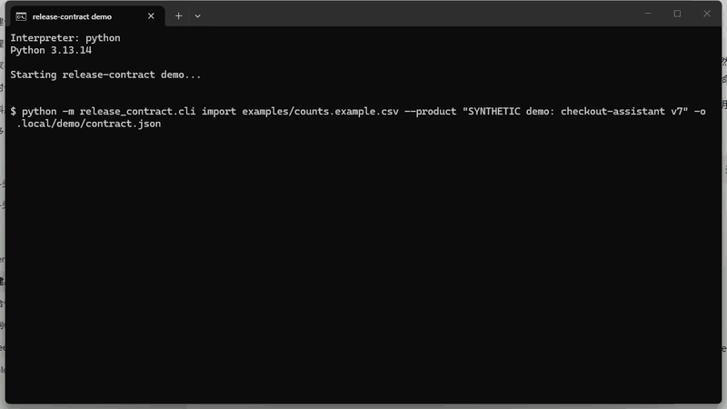
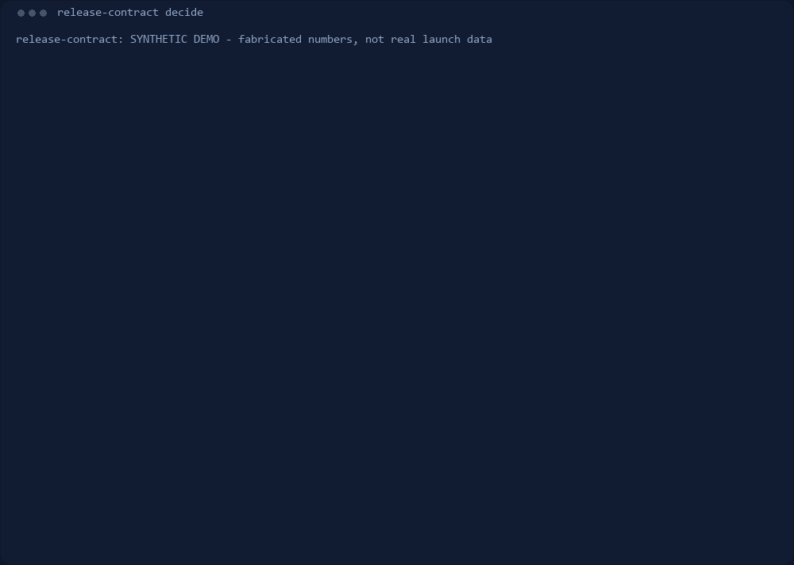

# release-contract

Decide which traffic segments of an AI product the offline evidence is strong
enough to release to — deterministically, with every gate visible.



_A real screen capture of one run on Windows 11 — console window only, nothing
staged. `assets/demo-recording.json` records the SHA-256 and exactly what was
cropped or scaled._



_This second one is re-rendered from live command output instead of captured, so
the self-check can fail when the engine changes without it._

Version: 0.3.0 · MIT · [中文说明](README.zh-CN.md)

Design decisions: [DESIGN.md](DESIGN.md) · Changelog: [CHANGELOG.md](CHANGELOG.md)

> Not an eval framework: it does not measure quality. It decides where the
> existing evidence justifies letting the model act alone.

## Scope

Upstream, `complaint-to-eval` answers "what should we test"; this skill
answers "can we ship". They are complementary: one produces case candidates,
the other decides whether the evidence is strong enough to release.

## Why

One headline eval number cannot answer a launch question. A contract splits
traffic into segments and asks, per segment: automate, fence, or wait?
Averaging everything into one green score hides the expensive blind spot.

Offline results must be reported as raw counts. At n=30, successes=30 the
observed rate is 1.000, but the Wilson lower bound is 0.8865 — below the 0.9
bar — so zero observed failures is still not proof. Two segments with the
same 0.970 point estimate can get opposite verdicts purely because their
interval widths differ.

| n | successes | observed | Wilson lower |
|---|---|---|---|
| 30 | 30 | 1.000 | 0.8865 |
| 400 | 388 | 0.970 | 0.9483 |
| 1000 | 970 | 0.970 | 0.9575 |

## 30-second example

Start from a valid template, replace the counts, decide:

```
python -m release_contract.cli init -o contract.json    # n=0 -> HOLD by design
# replace n / successes with your real eval counts
python -m release_contract.cli decide contract.json
```

The bundled demo shows a partial release:

```
python -m release_contract.cli decide examples/demo_contract.json
```

```
SEGMENTS
  routine_faq            AUTO   share= 60.0%  observed=0.970  wilson_lower=0.948  cost=0.020
  billing_dispute        HOLD   share= 25.0%  observed=0.983  wilson_lower=0.911  cost=0.850
  contract_redline       FENCE  share= 10.0%  observed=0.990  wilson_lower=0.971  cost=0.030

TRAFFIC (denominator = full traffic 1.0)
  auto         60.0%
  fence        10.0%
  hold         25.0%
  uncovered     5.0%
  total       100.0%
```

The demo is fabricated (SYNTHETIC DEMO) and deliberately shows a partial
release: 60.0% AUTO, 25.0% HOLD, 10.0% FENCE, 5.0% undeclared traffic.

## The 6 gates

| gate | effect |
|---|---|
| G1_SAMPLE | n below min_sample_size → HOLD (missing evidence, not a failure) |
| G2_WILSON | Wilson lower bound below min_success_rate → FENCE |
| G3_HARM | harm_if_wrong above max_harm → FENCE, regardless of accuracy |
| G4_FALLBACK | high-harm segment with fallback=none → FENCE |
| G5_COST | loaded cost including human fallback above budget → FENCE |
| G6_COVERAGE | global: undeclared traffic is reported, never hidden |

Strictness is HOLD > FENCE > AUTO. Every triggered gate is printed with its
reason, so a NO-GO can be argued with instead of just accepted. The four
traffic buckets always sum to full traffic 1.0, never to a chosen subset.

Evidence-risk flags are advisory and never change a verdict. Otherwise the
tool could be tuned to look good.

## Commands

| command | what it does |
|---|---|
| `python -m release_contract.cli init -o contract.json` | write a valid starter contract (n=0, so it decides `HOLD`) |
| `python -m release_contract.cli import counts.csv --product "checkout v7" -o contract.json` | build a contract from a CSV of raw counts |
| `python -m release_contract.cli validate contract.json` | check structure and coverage without deciding |
| `python -m release_contract.cli decide examples/demo_contract.json` | human-readable decision |
| `python -m release_contract.cli decide examples/demo_contract.json --json` | stable-key JSON for golden diffs |
| `python -m release_contract.cli gates` | list the gates |
| `python -m release_contract.cli eval` | run dev and hold-out suites |
| `python -m release_contract.cli version` | print version |
| `python -m release_contract.cli diff examples/demo_contract.json examples/demo_contract_v2.json` | compare two versions segment by segment |

`decide --fail-on FENCE,HOLD` returns a non-zero exit code if any segment
hits a listed verdict, and `diff --fail-on-regression` returns the same code
when a segment got worse. Exit codes are the pipeline interface:

| code | meaning |
|---|---|
| 0 | decided, nothing the caller asked to fail on |
| 2 | a gate the caller opted into (`--fail-on` / `--fail-on-regression`) was hit |
| 3 | unusable input: missing file, malformed JSON, or a rejected contract |

An invalid contract prints one line on stderr and exits 3 — never a traceback.

`import` reads `id`, `n`, `successes` plus optional `volume_share`,
`harm_if_wrong`, `fallback`, `cost_per_case`, `human_review_cost`
(`examples/counts.example.csv`). A `success_rate` or `accuracy` column is
**refused with the reason**: a rate without its denominator is the thing this
tool will not accept. Unknown columns are refused too, so a typo cannot become
a silent default.

## Eval sets

Two fabricated suites, grouped by structural kind rather than by keywords.
Scoring unit is the per-segment verdict; the denominator is printed.

| suite | cases | scored segments | verdict accuracy | Wilson 95% CI |
|---|---|---|---|---|
| dev | 25 | 32 | 1.0000 | [0.8928, 1.0] |
| holdout | 25 | 35 | 1.0000 | [0.9011, 1.0] |

Both scores are 1.0000 because the golden labels were written by the author
of the rules, one branch per gate. That proves rule consistency and offline
replay, **not** real-world effectiveness. The intervals stay wide. See
`eval/README.md` for why it looks good, what is unscored, and the reverse
tests that prove each gate is load-bearing. Treat that table as a
**rule-consistency score**, not an effectiveness result or a headline number.

## Independent evidence

Two checks do not depend on author-written golden labels:

- `python scripts/property_scan.py` scans a fixed-seed parameter space and
  asserts eight invariants: traffic accounting, byte-identical replay, Wilson
  monotonicity, ablation monotonicity, invalid-input rejection, segment-order
  invariance, "more successes never stricter", and "higher floor never
  looser". A violation is a bug, not a disagreeing label. The scan itself is
  tested with planted bugs (`tests/test_properties.py`), so a silent pass
  cannot mean "the checks never fire".
- `python scripts/blind_eval.py` compares an independent annotator with the
  engine using answer-free prompts in `eval/blind/`. See
  `eval/blind/README.md` for the protocol. Fill
  `answer_sheet.template.csv` and pass the CSV path to the script; undecided
  rows are skipped, never guessed.
- `python scripts/publish_round.py` freezes a round: it scores a filled sheet
  and writes `result.json`, refusing to overwrite a different published result
  without `--force`. A round is publishable only when its sheet ships with it.
- `python scripts/compare_rounds.py a.csv b.csv` reports inter-annotator
  agreement between two rounds on their shared segments: paired count, percent
  agreement and **Cohen's kappa**, plus each reader's agreement with the engine
  on the same subset. Percent agreement alone would flatter two readers who
  both default to `AUTO`.
- `python scripts/logs_to_counts.py run.jsonl -o counts.csv` turns runtime
  logs (`{"segment": "...", "ok": true}` per line) into the counts CSV that
  `import` consumes. A record with no outcome is excluded from `n` and
  reported, never counted as a failure.
- `python scripts/check_rollback_baseline.py contract.json run_log.jsonl` closes
  the loop the trigger promise opens: it replays the launch's own log against the
  baselines `decide` recorded, window by window. A partial window never fires, a
  healthy window resets the run, and a segment that never appears in the log is
  reported as `no observations` instead of looking healthy. `--fail-on-trigger`
  exits 2 for a pipeline. Worked example: `examples/launch/`.
- `python scripts/whatif_rules.py` prices the two open rule questions in
  `DESIGN.md` against the published blind cases: which segments would change
  verdict, and how many. It implements neither scenario.
- `python scripts/demo.py` replays the whole flow with pauses, for a screen
  recording. It prints real output; nothing in it is scripted prose.

**Three blind rounds are published on the same 67 segments from 50 cases**, and a
fourth on a different 38-segment set: **0.8507** [0.7466, 0.9169], **0.9403**
[0.8563, 0.9765], **0.7910** [0.6793, 0.8712], and **0.8947** [0.7587, 0.9583].
Each `result.json` is regenerated by `scripts/publish_round.py`; the self-check
fails if a published number drifts. The fourth uses `eval/blind/next_batch/`, so
it must not be subtracted from the first three — see `eval/blind/README.md`.

They are not three independent scores. Across all 37 disagreements in all three
rounds, **every one falls into one of two rule questions and none is
unexplained** — the rates are exactly `1 - 10/67`, `1 - 4/67`, `1 - 14/67`:

- **Wilson-class** (10 fixed cases): the observed rate clears the floor, the
  lower bound does not, no other gate is violated. A reader reasoning on the
  point estimate produces all ten; one using the lower bound produces none.
- **Rule-class** (4 fixed cases): the two open questions in `DESIGN.md` — does an
  existing human fallback relax the harm ceiling, and should thin evidence plus a
  hard violation read `HOLD` or `FENCE`.

Pairwise reader agreement: 1↔2 kappa 0.6554, 1↔3 kappa **0.8929**, 2↔3 kappa
0.7498 (`scripts/compare_rounds.py`). Readers 1 and 3 agree tightly because they
share the point-estimate reading and differ only on the four rule cases. The
engine is on the minority side of both rule questions: 2 of 3 readers disagree
with it there.

Read the numbers as how far a reader's judgement sits from a deterministic rule
set on fabricated cases — never as accuracy on production traffic, and never one
rate alone. Per-round tables, reproduction commands and limits:
`eval/blind/rounds/round1/README.md`, `rounds/round2/README.md`,
`rounds/round3/README.md`.

What would falsify this tool: an independent annotator systematically
disagreeing with `AUTO` verdicts on high-harm segments (the opposite direction
from the observed bias), or a real launch where an `AUTO` segment needs a
rollback far more often than its recorded Wilson baseline predicts. Neither has
been measured.

## Not measured

- No real launch data, no real users, no real model output, no external
  annotation. There is no measured accuracy for evidence-risk flags or for
  real launch outcomes.
- The rollback check exists and is exercised on a **fabricated** log
  (`examples/launch/`). Nobody has yet shown that a recorded Wilson baseline
  predicts the real drift rate of a shipped segment — that is the single most
  useful measurement still missing.
- Three annotators is not a sample of annotators: kappas of 0.6554 / 0.8929 /
  0.7498 are a band with no interval, and all three answered the same 67
  fabricated cases.
- The fourth reader answered 30 different cases alone, not the 67 the other
  three used. Its 0.8947 cannot be subtracted from their rates or read as a
  trend: those cases were selected for coverage rather than sampled, and one
  reader is not a distribution.
- The engine is knowingly more conservative than a point-estimate read of the
  same numbers: it fences segments whose observed rate clears the floor while
  the Wilson lower bound does not. If your organisation intends point-estimate
  semantics, this tool will over-fence by design.
- The engine calls no LLM and no network; the same JSON produces a
  byte-identical decision. It cannot tell you whether your eval was well
  designed — a curated test set that hides edge cases still produces green
  verdicts.
- This is complementary to promptfoo / Langfuse (which run evals) and to
  ship-gate tools (which audit code and deployment). It replaces neither.

## Install

As an agent skill (works once the repository is published):

```
npx skills add jian935/release-contract
```

As a CLI, from a checkout (Python 3.10+):

```
python -m pip install .
release-contract --version
release-contract decide examples/demo_contract.json
```

Or run it without installing anything:

```
python -m release_contract.cli decide examples/demo_contract.json
python scripts/quick_validate.py
```

Zero third-party runtime dependencies — standard library only. `pyproject.toml`
exists so `pip` can build the console script; nothing in the engine needs it.

## License

MIT · Author: jian935
