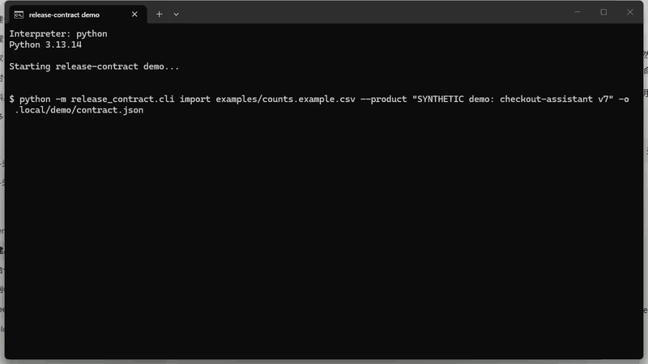
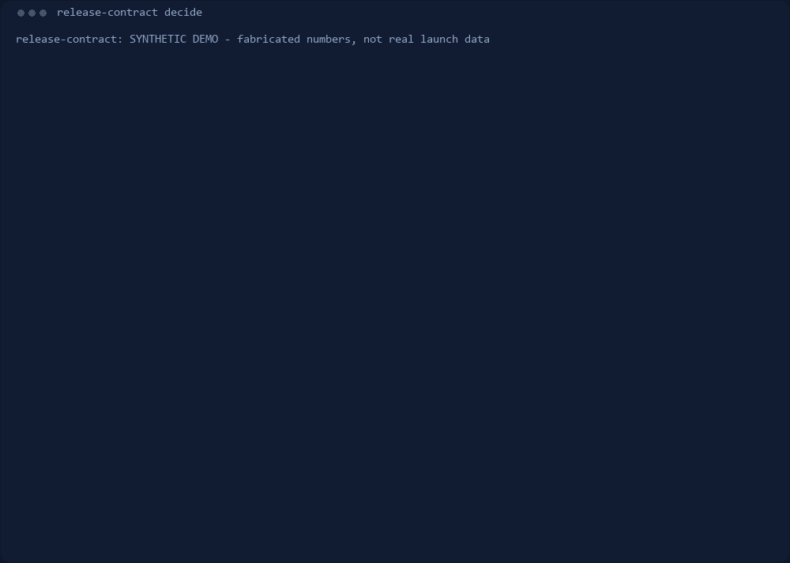

# release-contract

判定 AI 产品的离线证据，够不够支撑「哪些流量分片可以自动化放行」——确定性、每道闸都可见。



_这是 Windows 11 上一次真实运行的屏幕录制，只截了控制台窗口，没有摆拍。
`assets/demo-recording.json` 记录了 SHA-256 以及具体裁剪/缩放做了什么。_



_第二张是从实时命令输出重新渲染的，不是录制——这样才能让自检在「引擎改了、
图没更新」时直接报错。_

版本：0.3.0 · MIT · [English](README.md)

设计取舍：[DESIGN.md](DESIGN.md) · 变更记录：[CHANGELOG.md](CHANGELOG.md)

> 它不是评测框架：不测量质量，只判定现有证据足以让模型在哪些地方独立行动。

## 范围

上游的 `complaint-to-eval` 回答「该测什么」，本 skill 回答「能不能发」。
两者互补：前者产出用例候选，后者判定证据是否足以放行。

## 为什么

一个总分回答不了上线问题。契约把流量拆成分片，逐片问：放行、转人工，还是再等证据？
把所有分片平均成一个绿色分数，恰好会藏起最贵的那个盲区。

离线结果必须报原始计数。当 n=30、successes=30 时，观测率是 1.000，但
Wilson 下界只有 0.8865，低于 0.9 门槛——零失败同样不是证据。两个同为
0.970 点估计的分片，可能仅因区间宽度不同而得到相反判定。

| n | successes | observed | Wilson lower |
|---|---|---|---|
| 30 | 30 | 1.000 | 0.8865 |
| 400 | 388 | 0.970 | 0.9483 |
| 1000 | 970 | 0.970 | 0.9575 |

## 30 秒示例

从一个合法模板起步，把数字换成你自己的：

```
python -m release_contract.cli init -o contract.json    # n=0，按设计会判 HOLD
# 把 n / successes 换成真实评测计数
python -m release_contract.cli decide contract.json
```

内置演示展示一次「部分上线」：

```
python -m release_contract.cli decide examples/demo_contract.json
```

```
SEGMENTS
  routine_faq            AUTO   share= 60.0%  observed=0.970  wilson_lower=0.948  cost=0.020
  billing_dispute        HOLD   share= 25.0%  observed=0.983  wilson_lower=0.911  cost=0.850
  contract_redline       FENCE  share= 10.0%  observed=0.990  wilson_lower=0.971  cost=0.030

TRAFFIC (denominator = full traffic 1.0)
  auto         60.0%
  fence        10.0%
  hold         25.0%
  uncovered     5.0%
  total       100.0%
```

演示数据是编造的（SYNTHETIC DEMO），故意展示一次「部分上线」：
60.0% AUTO、25.0% HOLD、10.0% FENCE、5.0% 未声明流量。

## 6 道闸

| 闸 | 作用 |
|---|---|
| G1_SAMPLE | n 低于 min_sample_size → HOLD（证据缺失，不等于失败） |
| G2_WILSON | Wilson 下界低于 min_success_rate → FENCE |
| G3_HARM | harm_if_wrong 超过 max_harm → FENCE，与准确率无关 |
| G4_FALLBACK | 高危分片且 fallback=none → FENCE |
| G5_COST | 含人工兜底的完全成本超预算 → FENCE |
| G6_COVERAGE | 全局：未声明流量必须报出，不许隐藏 |

严格度 HOLD > FENCE > AUTO。每条触发的闸都带理由打印，NO-GO 可以被反驳而不是只能接受。
四个流量桶恒等于全量 1.0，分母不允许自己挑。

证据风险标记只是提示，绝不改变判定；否则工具就能被调到「看起来好看」。

## 命令

| 命令 | 作用 |
|---|---|
| `python -m release_contract.cli init -o contract.json` | 写出合法起步合约（n=0，所以会判 `HOLD`） |
| `python -m release_contract.cli import counts.csv --product "checkout v7" -o contract.json` | 从原始计数 CSV 生成合约 |
| `python -m release_contract.cli validate contract.json` | 只校验结构与覆盖，不做判定 |
| `python -m release_contract.cli decide examples/demo_contract.json` | 人类可读的判定报告 |
| `python -m release_contract.cli decide examples/demo_contract.json --json` | 稳定键序 JSON，用于 CI golden diff |
| `python -m release_contract.cli gates` | 列出六道闸 |
| `python -m release_contract.cli eval` | 跑 dev 与 hold-out 两套 |
| `python -m release_contract.cli version` | 打印版本 |
| `python -m release_contract.cli diff examples/demo_contract.json examples/demo_contract_v2.json` | 逐分片对比两个版本 |

`decide --fail-on FENCE,HOLD` 在任一分片命中列出的判定时返回非零退出码；
`diff --fail-on-regression` 在有分片变差时返回同一个码。退出码就是流水线接口：

| 码 | 含义 |
|---|---|
| 0 | 判定完成，没有命中调用方要求卡住的条件 |
| 2 | 命中了调用方主动开启的闸口（`--fail-on` / `--fail-on-regression`） |
| 3 | 输入不可用：文件不存在、JSON 格式错、或合约被拒 |

合约不合法时只在 stderr 打一行并退出 3，**不会抛 traceback**。

`import` 读 `id`、`n`、`successes`，可选 `volume_share`、`harm_if_wrong`、
`fallback`、`cost_per_case`、`human_review_cost`（示例见
`examples/counts.example.csv`）。若出现 `success_rate` 或 `accuracy` 列会被**拒绝并说明原因**：
没有分母的比率正是这个工具不接受的东西。未知列同样拒绝，打错字不会静默变成默认值。

## 评测集

两套编造的评测集，按结构分层而不是按关键词划分。计分单位是「逐分片判定」，分母随分数一同打印。

| suite | cases | scored segments | verdict accuracy | Wilson 95% CI |
|---|---|---|---|---|
| dev | 25 | 32 | 1.0000 | [0.8928, 1.0] |
| holdout | 25 | 35 | 1.0000 | [0.9011, 1.0] |

两套都是 1.0000，因为 golden 标注由规则作者按每道闸的分支直接写出。
这只能证明规则执行一致、可离线复跑，**不能**证明真实场景有效；区间依然很宽。
见 `eval/README.md`：为什么它跑出来好看、哪些项没有分数、以及证明每道闸都是承重墙的反向测试。
上表是**规则一致性分数**，不是有效性结果，不该被当成对外成绩。

## 独立证据

两项检查不依赖作者写的 golden 标注：

- `python scripts/property_scan.py` 用固定 seed 扫描参数空间，验证八条不变量：
  流量核算、逐字节复跑、Wilson 单调性、消融单调性、非法输入必拒、
  分片顺序无关、「成功数变多不会更严」、「下限抬高不会放宽」。
  违规就是真 bug，不是标注分歧。扫描器本身用**植入 bug**的单测验证过
  （`tests/test_properties.py`），所以「静默通过」不等于「检查从不触发」。
- `python scripts/blind_eval.py` 用 `eval/blind/` 里去掉答案的题面，
  把独立标注者与引擎判定对比。协议见 `eval/blind/README.md`。
  填好 `answer_sheet.template.csv` 后把 CSV 路径传给脚本；未决行跳过，不猜。
- `python scripts/publish_round.py` 冻结一轮：给填好的表打分并写出 `result.json`，
  结果不同时拒绝覆盖（除非显式 `--force`）。**表不入库的回合不予发布。**
- `python scripts/compare_rounds.py a.csv b.csv` 算两轮之间在共同分片上的一致性：
  配对数、原始一致率、**Cohen's kappa**，以及两位读者各自与引擎的一致率。
  只报原始一致率会美化「两个人都默认 AUTO」这种情况。
- `python scripts/logs_to_counts.py run.jsonl -o counts.csv` 把运行时日志
  （每行 `{"segment": "...", "ok": true}`）转成 `import` 直接吃的计数 CSV。
  **没有结果的记录会从 `n` 里剔除并单独计数**，绝不当成失败。
- `python scripts/check_rollback_baseline.py contract.json run_log.jsonl` 是
  「回退触发条件」的另一半：拿上线后的日志，逐窗口对照 `decide` 当初记下的基线。
  **不完整的窗口永不触发**、正常窗口会把连续计数清零、日志里从未出现的分片报
  `no observations` 而不是当作健康。`--fail-on-trigger` 触发时退出码 2，可接流水线。
  完整示例见 `examples/launch/`。
- `python scripts/whatif_rules.py` 把 `DESIGN.md` 里那两个待决规则问题换算成判定数：
  各自会让哪些分片改变结论、一共几条。**两个场景都没有实装**。
- `python scripts/demo.py` 带停顿重放整套流程，方便录屏；打印的全是真实输出，没有脚本台词。

**盲评已发布三轮，都是同样 50 个案子、67 个分片**：**0.8507** [0.7466, 0.9169]、
**0.9403** [0.8563, 0.9765]、**0.7910** [0.6793, 0.8712]。
第四位读者回答了另一套 38 个分片，得 **0.8158** [0.6658, 0.9078]——不同题库上的
人工轮次，与前三轮算不出 kappa。各轮 `result.json` 都由 `scripts/publish_round.py`
重新生成，数字漂移就让构建失败。另有**模型**回答了同一套 38 个分片，得
**0.8947** [0.7587, 0.9583]；那份表放在 `eval/blind/model_check/`，
标着 `"kind": "model_check"`，**不算第五位读者**，详见 `eval/blind/README.md`。

它们不是三个独立成绩。三轮共 37 条分歧，**每一条都能归到两个规则问题之一，零残余**——
三个数恰好是 `1 - 10/67`、`1 - 4/67`、`1 - 14/67`：

- **Wilson 类**（固定 10 例）：点估计过了下限、Wilson 下界没过，且没触发其他闸。
  用点估计的读者会产生这 10 条，用下界的读者一条也不会。
- **规则类**（固定 4 例）：`DESIGN.md` 里那两个待决问题——**人工兜底能否放松危害上限**、
  **证据不足又撞硬上限时该报 `HOLD` 还是 `FENCE`**。

标注者两两一致率：1↔2 kappa 0.6554、1↔3 kappa **0.8929**、2↔3 kappa 0.7498
（`scripts/compare_rounds.py`）。读者 1 与 3 高度一致，是因为两人共用点估计口径、
只在 4 条规则类上分歧。**在这两个规则问题上，引擎处于少数方**：3 位读者里有 2 位不同意它。

这些数字应读作「读者的判断离一套确定性规则有多远」（而且是在编造的用例上），
不是线上准确率，也不能单独引用其中任何一个。分轮完整表、复现命令与局限见
`eval/blind/rounds/round1/README.md`、`rounds/round2/README.md`、
`rounds/round3/README.md`、`rounds/round4/README.md`。

什么能证伪它：独立标注者系统性不认同高危分片上的 `AUTO` 判定（与观测到的偏差方向相反）；
或真实上线中某个 `AUTO` 分片的回退频率远高于其记录的 Wilson 基线所预测。
两者都还没有测过。

## 未测

- 没有真实上线数据、没有真实用户、没有真实模型输出、没有外部标注。
  证据风险标记与真实上线结果都没有实测准确率。
- 回退自检已经有了，但只在**编造的**日志上跑过（`examples/launch/`）。
  「记录的 Wilson 基线能否预测某个已放行分片的真实漂移率」还没有任何人验证过——
  这是目前最缺、也最有用的一个测量。
- 三位标注者不构成「标注者分布」：kappa 0.6554 / 0.8929 / 0.7498 是一个带，没有区间；
  而且三人回答的是同一批 67 个**编造**的用例。
- 第四轮是另一位读者在另一套题上的一次判断，不是对前三轮的重复测量：与前三轮没有 kappa，
  也构不成趋势。同一套 38 个分片另有模型作答，得 0.8947——那是模型在复现规则，不是人判断
  一次发布该不该放行，它的理由里直接算了 Wilson 下界。
- 引擎在同类数字上**明知比点估计更保守**：点估计过线而 Wilson 下界不过线的分片会被拦。
  若你所在组织的口径就是点估计，它按设计会多拦。
- 引擎不调用大模型、不访问网络；同一份 JSON 产出逐字节一致的判定。
  它无法判断你的评测设计得好不好——藏掉边界样本的评测集照样能跑出绿色。
- 与 promptfoo / Langfuse（跑评测）和 ship-gate 类工具（审代码与部署）是互补关系，不替代任何一方。

## 安装

作为 agent skill：

```
npx skills add jian935/release-contract
```

作为 CLI，在克隆目录里（Python 3.10+）：

```
python -m pip install .
release-contract --version
release-contract decide examples/demo_contract.json
```

或者完全不安装：

```
python -m release_contract.cli decide examples/demo_contract.json
python scripts/quick_validate.py
```

运行时零第三方依赖，只用标准库。`pyproject.toml` 只是让 `pip` 能构建出命令行入口，
引擎本身不需要它。

## 许可

MIT · 作者：jian935
